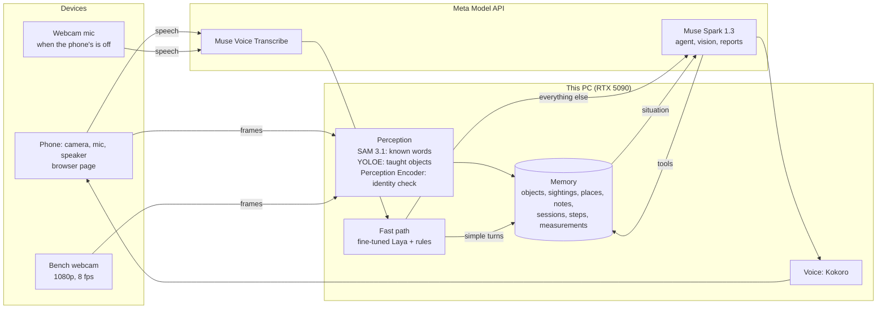

# ForgeMind

A workshop assistant with eyes, ears and memory. A camera mounted over your bench and the
phone in your hand feed a memory that lasts across days; you talk to it hands-free, and an
agent on Meta's Muse models answers.

> Today **you are the robot's body**: when the agent needs to see something, it asks you to
> point the phone. The same requests ("look at", "highlight", "read this") can drive a robot later.

Built for the Meta Global AI Developer Hackathon (Oct 26 – Nov 4, 2026), indie track, theme
*Push the Frontier*. Demo script: [`docs/video_script.html`](docs/video_script.html).

## What it does

- **Teach your things.** Hold something up and say "these are my clippers": a green box shows
  what it stored, and from then on it is recognised by the phone and the bench camera, even
  objects it has no word for (it found a baby's teether across the room minutes later).
- **Where is it?** "Where's my baby's biter?" It answers from what it has seen (camera, place,
  time), checks the live view, and says honestly when it can't see it.
- **What do you see?** It looks through the camera you're using and describes it.
- **Two cameras, one view.** "Switch to the desk camera" shows the mounted camera on your phone,
  with what it recognises boxed; "switch back to my phone" returns.
- **Remembers what you tell it.** "Remember that my ML books are on the second shelf",
  "this is my secondary bench": places and facts are kept and used in later answers.
- **Work sessions.** "Start a session called voltage test", "the steps are ...", "I wired the
  divider", "I measured 3.3 volts on the output", "write it up": steps are ticked off,
  measurements logged, and a report is written in which every fact cites its source.
- **Corrections.** "That's not the timer, it's my stopwatch" moves the label.
- **Hands-free voice** in a natural voice; talk over it to interrupt.
- **Safety watch.** "Watch the soldering iron while I'm away" alerts the phone if it is left
  on the bench with nobody there.

## How it works



- **What runs where.** Everything that looks at every frame runs on the local GPU: SAM 3.1,
  YOLOE and Perception Encoder, about 230 ms per frame. Reasoning, reading displays, reports and
  speech recognition use the Meta Model API.
- **Fast path.** Simple turns (teach, where is, log a measurement, switch camera, watch) are
  decided locally by a fine-tuned Laya decision model and plain rules, and answered in under
  0.2 s without calling Spark. Writes made this way are re-checked by Spark in the background
  and undone with a spoken correction if it disagrees.
- **Design rules.** The model proposes, the code validates. Every fact has a source (seen by a
  camera, said by you, read from a display). Tools report what is missing or stale instead of
  trusting the model to notice. False "done" claims are caught. People are only ever "present",
  never identified.

### Models

| Model | From | Role |
|---|---|---|
| Muse Spark 1.3 | Meta (Model API) | The agent (tool calling, `reasoning_effort=minimal`), describing what's in view, reading displays, reports |
| Muse Voice Transcribe | Meta (Model API) | Hands-free speech to text |
| SAM 3.1 | Meta (open weights, local) | Finds objects by name on both cameras |
| Perception Encoder | Meta (open weights, local) | Object identity across cameras and views |
| Muse Glimmer 30B | Meta (open weights, local) | Generated the fast path's training data; simulated users in the evaluation |
| YOLOE | Ultralytics (AGPL-3.0, local) | Finds taught objects from the example you showed it |
| Laya, fine-tuned | Convai (Apache-2.0, local) | Fast-path decisions |
| Kokoro-82M | hexgrad (Apache-2.0, local) | The spoken voice |

## Results

Measured on this project (details in [`docs/EVAL.md`](docs/EVAL.md) and [`docs/HANDOFF.md`](docs/HANDOFF.md)):

| | |
|---|---|
| Agent tool choice, 19 scripted turns incl. real phrases from phone tests | **19/19**, median **1.8 s** (Nov 3) |
| Demo script rehearsal on saved frames, real models | 12/13 (the miss: it answered from the picture instead of calling a tool) |
| Taught objects found by YOLOE + PE on replayed phone frames | 19/19 sampled labels correct; ~230 ms per frame |
| Fast-path turns (teach, where is, measurement) | 0.03–0.2 s |
| Fast-path accuracy on 86 held-out phrases | 0.98 (fine-tuned Laya; 0.43 out of the box) |
| Bench camera to phone, direct Wi-Fi | 7.8 frames/s, 39 ms per picture |
| API spend for building and testing | about $5 (own estimate; check the console) |

**Live is slower than these numbers.** In phone tests, Spark turns took 3–10 s: most of it is
Spark's own reasoning and Meta API latency from here (a bare "Say ok." took 1.6–8 s on some days).

## Run it (Windows, RTX 50-series)

```bash
uv venv --python 3.12
.venv\Scripts\activate
uv pip install -e ".[vision,dev]"
uv pip install torch torchvision --index-url https://download.pytorch.org/whl/cu128
uv pip install -e ".[local]"                         # SAM 3 (gated: request facebook/sam3.1 on Hugging Face), PE, Laya, Kokoro
uv pip install --no-deps ultralytics ultralytics-thop # YOLOE without a second OpenCV
uv pip install matplotlib polars
hf auth login
copy .env.example .env                               # set MODEL_API_KEY, FM_TOKEN, FM_YOLOE_WEIGHTS, FM_SYSTEM1, FM_TTS=kokoro
pytest -q                                            # no downloads, no network
```

Then:

```bash
forgemind serve --zrok                               # prints the phone link (needs `zrok2 enable` once)
forgemind static-cam --device 0                      # the bench webcam
forgemind desk-mic                                   # optional: the webcam's mic when the phone's is off
```

- **Phone:** open the printed link, enter the access token (`FM_TOKEN`), tap *Start camera* and
  *Hands-free*.
- **Faster at home:** put a self-signed certificate in `<data dir>/certs/` (`cert.pem`, `key.pem`);
  the server then also serves `https://<this PC's Wi-Fi address>:8771/` directly, without the tunnel.
- Without an API key everything still runs on stand-ins (mock model).

| Command | Does |
|---|---|
| `forgemind serve [--zrok] [--mock]` | Server + phone page |
| `forgemind static-cam --device 0\|url\|file.mp4` | Bench camera (files replay at real speed) |
| `forgemind desk-mic` | Webcam mic, open only while the bench camera sees you and the phone's mic is off |
| `forgemind agent-eval` | Scripted turns against the real model: tools, time, cost |
| `forgemind spend` | API spend against the budget cap |
| `python eval/demo_rehearsal.py <data dir>` | The demo script on saved frames, real models |
| `python eval/replay_teach.py <data dir> --names a,b` | Teach on saved phone frames and check what gets labelled |

## Privacy

- Memory, camera stills and taught examples stay on this PC (`forgemind-data/`, not in git).
- Speech goes to Muse Voice Transcribe. A phone or bench picture goes to Muse Spark only when you
  ask something visual (and for about 10 s after), or for a close-up reading.
- *Pause cameras* stops all processing; *Private mode* stores nothing; a banner shows either.
- The link needs an access token; the token is never part of the link.

## Known limits

- Speed: Spark turns take several seconds live. Boxes update about once a second.
- Look-alike objects (two white bottles) can be confused; correct them by voice.
- Big things SAM and YOLOE can't box (a cooler, a cabinet) are taught from the middle of the view.
- The transcriber sometimes mishears ("Arduino" as "audio board").
- English only. Not a safety system: alerts are assistive.

## Layout

```
forgemind/
  agent/        orchestrator (turns, echo/scrap handling), system1 (fast path), tools, prompts
  perception/   frame pipeline, zones, bench region, safety watch
  memory/       events, objects (registry), sessions, notes
  providers/    Meta API, SAM 3.1, YOLOE, embedders, budget ledger
  server/       FastAPI app, phone page, voice relay, voice (Kokoro), tunnel
  cameras/      bench camera and desk mic clients
eval/           fast-path training and evaluation, replays, rehearsals
docs/           PRD, evaluation, handoff, submission text, video script
tests/          220+ tests
```

## Licence

[GNU AGPL-3.0](LICENSE). ForgeMind uses YOLOE through `ultralytics`, which is AGPL-3.0.
