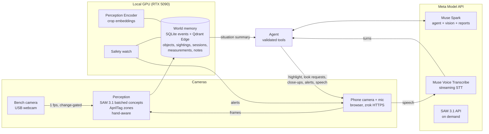

# ForgeMind

A workshop assistant with eyes, ears and memory. A fixed camera watches your bench, the
phone you carry is its moving eye, and a persistent world memory remembers where things
are and what you were doing. An agent on Meta's Muse models finds things, resumes
unfinished work, logs experiments, reads instrument displays and warns you when something
is unsafe.

> Today **you are the robot's body**: when the agent needs to see something it asks you to
> point the phone there. The same requests can drive a robot later.

Built for the Meta Global AI Developer Hackathon (Oct 26 – Nov 4, 2026), indie track,
theme *Push the Frontier*.

| Doc | What's in it |
|---|---|
| [`docs/EVAL.md`](docs/EVAL.md) | Scorecard: the six acceptance checks, agent accuracy and latency, perception speed, identity precision, cost |
| [`docs/DEMO.md`](docs/DEMO.md) | Demo script, setup checklist and shot list |
| [`docs/SUBMISSION.md`](docs/SUBMISSION.md) | Draft text for the hackathon submission form |
| [`docs/PRD.md`](docs/PRD.md) | Product spec, model split (§7.3), lessons from Google's personal health agent paper (§7.4) |
| [`docs/META_INTEGRATION.md`](docs/META_INTEGRATION.md) | Each Meta model: setup, prices, status |
| [`docs/HANDOFF.md`](docs/HANDOFF.md) | Build log, blockers, next steps |

## What it does

- **Where is it?** "Where's my 2.5 mm hex key?" → "Last seen on the shelf by your phone, 20
  minutes ago." Walk there and the phone highlights it the moment it's in view. If memory
  is stale it asks you to look, and remembers when something wasn't there.
- **Teach your things.** "This is my soldering iron": a few views from the phone become a
  personal identity, recognised by both cameras.
- **Work continuity.** Sessions with planned steps, settings and measurements; "let's
  continue yesterday's divider test" → what's done and what's next.
- **Read instruments.** "Read the multimeter" → a close-up photo, read by Muse Spark's
  vision, logged as an instrument reading. It refuses OL, blank or ambiguous displays.
- **Safety watch.** The iron on the bench with nobody there → an alert on your phone, with
  where you are.
- **Reports.** "Write it up" → a report where every fact cites the memory event it came
  from; numbers that aren't in the record are removed, missing values are flagged.
- **Hands-free voice.** Just talk; an instant "Let me check." while the agent works, and
  replies in a natural voice (Kokoro, local) instead of the phone's robotic one.

## How it works



**Model split** (PRD §7.3): anything that runs on every frame, or that the API doesn't
offer, runs on the local GPU (SAM 3.1, Perception Encoder). Reasoning, display reading,
reports and speech recognition use the Meta Model API. Meta models throughout: Muse Spark,
Muse Voice Transcribe, SAM 3.1 (open weights locally, API on demand), Perception Encoder,
and Muse Glimmer tested as a local fallback.

**Design rules.** Memory is written on change, never every frame. The agent sees a compact
situation summary, not raw streams. The model proposes, the app validates. Every fact has
provenance (which camera, said by you, read from an instrument, inferred). Tools report
what is missing or stale instead of trusting the model to notice. People are only
"present", never stored as identities; pause and private mode are on the phone.

## Quick start (Windows, RTX 50-series)

```bash
uv venv --python 3.12
.venv\Scripts\activate
uv pip install -e ".[vision,dev]"
uv pip install torch torchvision --index-url https://download.pytorch.org/whl/cu128
uv pip install -e ".[local]"          # SAM 3 (gated: request facebook/sam3.1 on Hugging Face) + PE
hf auth login
copy .env.example .env                # then set MODEL_API_KEY
pytest -q                             # no downloads, no network
forgemind check                       # the Model API answers and returns tool calls
forgemind serve --zrok                # prints the phone link (HTTPS, needed for camera + mic)
```

Without a key everything still runs on stand-ins (mock model, CLIP-tile detector).

- **Phone:** open the printed `https://…/?t=…` link, tap *Start camera*, then *Hands-free*
  (or hold *Hold* to talk). *Teach object* names the thing in front of the camera.
- **Bench camera:** `forgemind static-cam --device 0 --token <t>` (a USB webcam), or an old
  phone with `&role=static`. Point it down at the bench; `forgemind bench-region <video>
  --write` masks the keyboard/laptop area.
- **Zones:** `forgemind tags` writes `zone-tags.png`; stick one tag in each zone.
- **Teach** your soldering iron as "soldering iron" and your multimeter: SAM 3.1 doesn't
  detect irons by name, and the safety watch matches the taught name.

## Commands

| Command | Does |
|---|---|
| `forgemind serve [--zrok] [--mock]` | App server + phone page |
| `forgemind static-cam --device 0\|url\|file.mp4 [--loop] [--send-px 2560]` | Bench camera client: webcams captured at 4K, sent at 2560 px; files replay at real speed |
| `forgemind check` | Model API smoke test: models, tool call |
| `forgemind agent-eval [--frames] [--model …]` | 15 scripted turns against the real model: tools, latency, cost |
| `forgemind replay video.mp4 --camera static\|mobile` | Recorded video through perception + memory; entity contact sheet |
| `forgemind calibrate photos/` | Compare embedders on your objects; recommends thresholds |
| `forgemind concepts frames… --phrases "a,b"` | Compare SAM phrasings on sample frames |
| `forgemind bench-region video [--roi] [--write]` | Suggest bench crop/masks |
| `forgemind spend` | API spend against the budget cap |
| `forgemind tags` | Printable AprilTag zone sheet |

## Layout

```
forgemind/
  config.py, runtime.py   settings; wiring
  hub.py                  phone push channel, look / capture / seek requests ("the body")
  providers/              model slots (Meta API + metering, compat/Glimmer, mock), SAM local/API/Modal,
                          CLIP / Perception Encoder, fallback, budget ledger
  perception/             frame pipeline (hand-aware, move linking), zones, bench region, safety
  memory/                 SQLite events, Qdrant Edge, object registry, experiments, user notes
  agent/                  tools (validated), prompts, orchestrator (+ false-claim guard)
  server/                 FastAPI app, phone page, Voice Transcribe relay, zrok
  reports.py              reports with [E#] provenance + citation check
  agent_eval.py, replay.py, calibrate.py, concepts.py   evaluation tools
tests/                    80+ tests: memory, perception, agent, where_is, safety, reports, notes, ASR, budget
deploy/                   Modal SAM fallback, Dockerfile + compose
```

## Known limits

- Not yet run live on the real bench and phone (the scorecard's acceptance checks pass in
  automated tests and against the real Meta API).
- SAM 3.1 never answers to "soldering iron"; teach the iron. "multimeter" also fires on
  digital stopwatches; teach the meter.
- Identical-looking untaught objects (two identical tracks) can't be told apart by
  appearance; place and recency carry their identity.
- English only. Phone hands-free sends silence while it speaks, so interrupt by tapping.
- Not a safety system: alerts are assistive.
